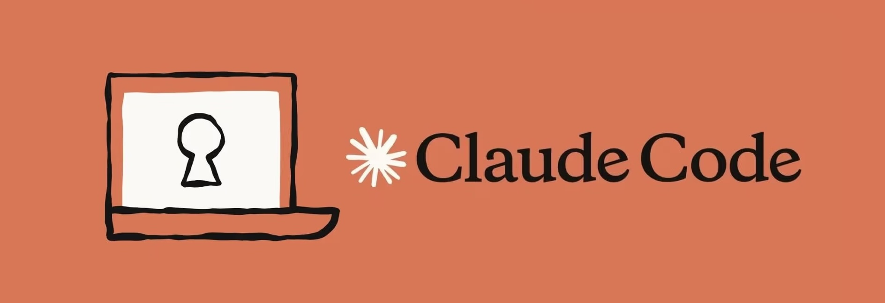
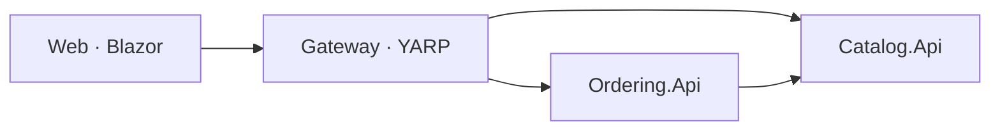

# Développement agentique avec Claude Code

**Formation pour Dev & DevOps — de la formulation d’un prompt au diagnostic d’incident.**



[Support de formation](slides/formation.pdf) · [Parcours des labs](labs/README.md) · [Application ECommerce](ecommerce-app/README.md) · [Contact](mailto:bassem.benhamed@enetcom.usf.tn)

## Présentation

Ce dépôt rassemble les supports et les exercices d’une formation en français consacrée au développement agentique avec Claude Code. Il s’adresse aux développeurs .NET, aux tech leads et aux profils DevOps qui souhaitent intégrer un agent dans leur travail quotidien, avec des objectifs précis, des contrôles et des preuves de validation.

Le parcours comprend **12 labs progressifs, un atelier plugin et un capstone**. Une application ECommerce .NET sert de fil rouge : chaque étape répond à un problème concret et enrichit le code ou les outils de l’équipe.

## Compétences travaillées

- **Construire un prompt** : rôle, contexte, instruction, contraintes, format et exemples ; techniques zero-shot, few-shot, CoT et prompt chaining.
- **Structurer le travail de l’agent** : contexte projet, skills, commandes, permissions et hooks.
- **Tester et sécuriser** : tests d’intégration, migrations, gestion des secrets et audit des dépendances.
- **Déléguer et connecter** : sous-agents spécialisés, serveurs MCP et plugin d’équipe.
- **Industrialiser et déployer** : CI/CD, images Docker, Kubernetes et Helm.
- **Observer et diagnostiquer** : télémétrie métier, traces, recherche de régression et post-mortem.

## Parcours pédagogique

| Étape | Labs | Résultat attendu |
|---|---|---|
| Prendre en main et formuler | [Lab 0](labs/lab0-prise-en-main/README.md), [lab 1](labs/lab1-git-github/README.md) | Comprendre l’application, construire un prompt et livrer un correctif ciblé. |
| Vérifier et sécuriser | [Lab 2](labs/lab2-tests/README.md), [lab 3](labs/lab3-securite-secrets/README.md) | Couvrir les comportements, organiser les revues et poser les contrôles de sécurité. |
| Connecter et partager | [Lab 4](labs/lab4-postgresql/README.md), [lab 5](labs/lab5-frontend/README.md), [atelier plugin](labs/atelier-plugin-dotnet-team/README.md) | Ajouter PostgreSQL, vérifier l’interface et distribuer les outils d’équipe. |
| Industrialiser | [Lab 6](labs/lab6-ci-cd/README.md), [lab 7](labs/lab7-conteneurs/README.md) | Automatiser les contrôles et rendre le lancement reproductible. |
| Déployer et observer | [Lab 8](labs/lab8-kubernetes/README.md), [lab 9](labs/lab9-helm/README.md), [lab 10](labs/lab10-observabilite/README.md) | Diagnostiquer un cluster, gérer les environnements et exploiter la télémétrie. |
| Diagnostiquer et intégrer | [Lab 11](labs/lab11-incident/README.md), [capstone](labs/capstone/README.md) | Résoudre un incident, puis livrer une fonctionnalité complète sous porte qualité. |

Les labs 0 à 5 et l’atelier constituent le socle développeur. Les labs 6 à 11 prolongent le parcours vers l’industrialisation et l’exploitation. Le capstone réunit les acquis autour d’une date de livraison souhaitée pour les commandes.

Chaque énoncé précise le point de départ, les étapes, les critères d’acceptation, les preuves attendues et les aides progressives. Consultez le [guide des labs](labs/README.md) pour l’installation des configurations et la reprise d’une étape.

## Application fil rouge

L’application ECommerce propose un catalogue, un panier et la création de commandes. Elle repose sur **.NET 10**, **ASP.NET Core**, **Blazor**, **YARP**, **EF Core** et **.NET Aspire**.



Aspire orchestre les services et fournit le tableau de bord de développement. L’application de départ utilise un stockage en mémoire. Les tests, PostgreSQL, les contrôles de sécurité, les conteneurs et les déploiements sont ajoutés au fil des labs.

Le dossier [`ecommerce-app/`](ecommerce-app/README.md) conserve cet état initial ; les corrigés se trouvent dans `labs/*/solution/`.

## Prérequis

Une pratique de C#, des API HTTP, de Git et des tests automatisés est attendue, ainsi que les bases de Docker pour la suite du parcours.

| À partir de | Outils nécessaires |
|---|---|
| Lab 0 | SDK .NET 10, Git, Claude Code avec un compte actif et `jq`. |
| Lab 1 | Compte GitHub et CLI `gh` authentifiée. |
| Lab 3 | `gitleaks` pour la détection des secrets. |
| Lab 4 | Docker pour PostgreSQL et Testcontainers. |
| Lab 5 | Node.js 20 ou supérieur pour le serveur MCP Playwright. |
| Lab 7 | Trivy ou Docker Scout pour le scan des images. |
| Labs 8 et 9 | `k3d`, `kubectl` et `helm`. |
| Lab 10 | Grafana LGTM, lancé en conteneur selon l’énoncé. |

Les outils complémentaires et leurs réglages sont détaillés dans chaque lab. Docker n’est pas nécessaire pour lancer l’application de départ.

## Démarrage rapide

Depuis la racine de votre copie locale de ce dépôt, créez votre espace de travail :

```bash
export FORMATION="$PWD"
cp -R "$FORMATION/ecommerce-app" "$HOME/lab-ecommerce"
cd "$HOME/lab-ecommerce"

git init -b main
git add .
git commit -m "État initial de l’application"
```

Puis préparez le certificat de développement et lancez l’application :

```bash
dotnet dev-certs https --trust
dotnet build ECommerce.slnx
dotnet run --project src/ECommerce.AppHost
```

Ouvrez l’URL `Login URL` affichée dans le terminal pour accéder au tableau de bord Aspire, puis la ressource `web` pour utiliser l’application. Arrêtez l’AppHost avec `Ctrl+C`.

Poursuivez avec le [lab 0 — Prise en main](labs/lab0-prise-en-main/README.md). Conservez la variable `FORMATION` dans votre configuration de terminal : les commandes des labs l’utilisent pour retrouver les ressources du cours.

## Organisation du dépôt

```text
.
├── README.md                 Présentation et démarrage
├── claude-code.jpg           Visuel de la formation
├── ecommerce-app/            Application de départ
├── labs/
│   ├── README.md             Parcours et conventions
│   ├── lab0-prise-en-main/
│   ├── …
│   ├── lab11-incident/
│   ├── atelier-plugin-dotnet-team/
│   └── capstone/
└── slides/
    └── formation.pdf         Support de présentation
```

Dans chaque lab, `.claude/` contient les configurations, skills, hooks et agents ; `ressources/` et `solution/` sont présents selon les besoins. Les configurations s’enrichissent progressivement et les corrigés s’appliquent dans l’ordre du parcours.

## Méthode de travail

Travaillez dans votre copie `lab-ecommerce`. Pour chaque étape : comprendre le besoin, explorer le code, définir les critères, réaliser la modification et vérifier le résultat.

Conservez les preuves sous `preuves/labN/` dans cette copie : commandes exécutées, résultats, décisions et captures utiles. Une modification est évaluée à partir du diff et des contrôles réellement exécutés. Le code, les commentaires et les messages de l’application restent en anglais ; les supports et les échanges pédagogiques sont en français.

## Auteur et contact

**Bassem Ben Hamed**  
[bassem.benhamed@enetcom.usf.tn](mailto:bassem.benhamed@enetcom.usf.tn)
